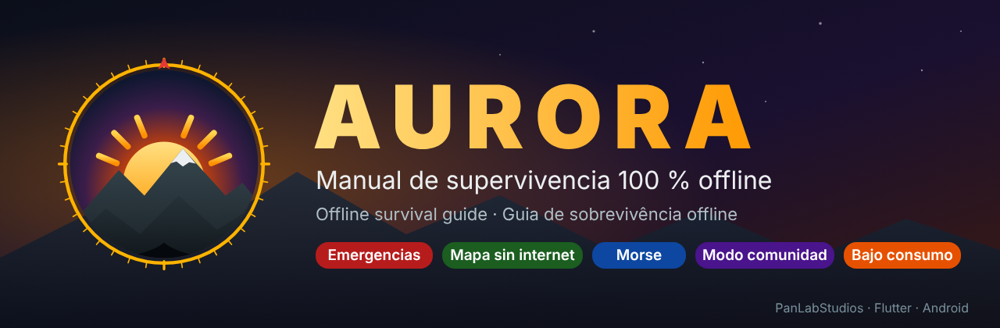
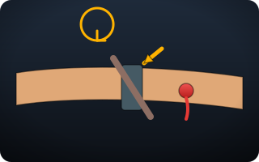
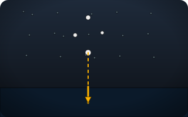
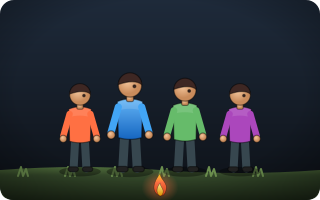
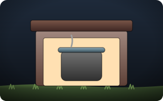
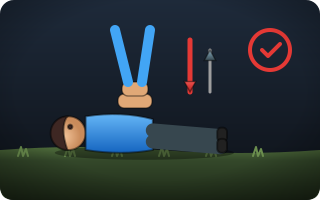
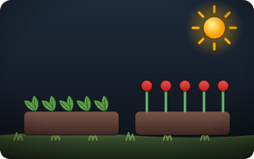

<p align="center">
  
</p>

<p align="center">
  <a href="../../releases/latest"></a>
  
  
  
  <a href="LICENSE"></a>
</p>

<p align="center"><b>Si se cae internet, se va la luz o pasa lo peor, tu teléfono sigue sabiendo qué hacer.</b><br>
Primeros auxilios, agua, fuego, refugio, plantas, mapas, señales y comunidad — todo dentro de la app, sin conexión y gastando la mínima batería.</p>

---

## 📥 Descargar

1. Entra a **[Releases](../../releases/latest)** y baja el APK (`arm64-v8a` sirve para casi todos los teléfonos modernos).
2. Ábrelo en el teléfono y permite "instalar apps de orígenes desconocidos".
3. Listo: funciona sin internet desde el primer momento.

<!-- CAPTURAS -->
<!-- /CAPTURAS -->

## 🧭 Qué trae

<table>
<tr>
<td width="33%" align="center"><br><b>Emergencia paso a paso</b><br><sub>Sangrado, RCP, atragantamiento, nuclear, sismo, serpiente, perdido… en pantallas grandes, un paso a la vez.</sub></td>
<td width="33%" align="center"><br><b>Biblioteca ilustrada</b><br><sub>17 temas, 90+ lecciones con dibujos, 96 plantas y animales con foto (qué se come, qué cura, qué mata) y libros PDF.</sub></td>
<td width="33%" align="center"><br><b>Señales</b><br><sub>SOS con linterna, baliza SOS automática, silbato, Morse (escribir, descifrar y practicar), pantalla señal.</sub></td>
</tr>
<tr>
<td align="center"><br><b>Mapa sin internet</b><br><sub>Mapa vectorial de tu país en un archivo <code>.pmtiles</code>, GPS, puntos, brújula hacia un punto, grabar ruta, medir distancia y área, exportar GPX.</sub></td>
<td align="center"><br><b>Modo comunidad</b><br><sub>Provisiones, personas, signos vitales y mensajes compartidos entre teléfonos cercanos por hotspot Wi-Fi, sin internet y con PIN.</sub></td>
<td align="center"><br><b>Despensa y recetas</b><br><sub>Inventario con vencimientos, 25 recetas según lo que tienes (granos, panes, pastas, carnes, pescados), raciones y mochila de 72 h.</sub></td>
</tr>
<tr>
<td align="center"><br><b>Salud</b><br><sub>Metrónomo de RCP, pulso, ficha médica, alarmas de medicinas, torniquete y turnos de guardia, botiquín y jabón caseros.</sub></td>
<td align="center"><br><b>Radiación y desastres</b><br><sub>Calculadora de la regla 7-10, refugio, descontaminación, sismos, inundaciones, volcanes.</sub></td>
<td align="center"><br><b>Reconstruir</b><br><sub>Huerta, semillas, agua, energía, construcción, autoprotección, liderazgo y salud mental.</sub></td>
</tr>
</table>

## 🔋 Pensada para durar

| | |
|---|---|
| Pantalla a 60 Hz | Las pantallas de 120 Hz gastan mucho más (control nativo en `MainActivity`). |
| Negro puro AMOLED | Los píxeles negros no consumen. Modo nocturno rojo. |
| Brillo propio y atenuado | Se oscurece sola si no la tocas. Modo ahorro extremo con un toque. |
| Sin animaciones ni red de fondo | GPS, red y sensores solo cuando tú los pides. |

## 🗺️ Mapa sin internet

```powershell
powershell -ExecutionPolicy Bypass -File .\tool\mapa_offline.ps1                 # Colombia hasta zoom 14
powershell -ExecutionPolicy Bypass -File .\tool\mapa_offline.ps1 -Zona bogota -MaxZoom 15
```

Baja la herramienta [`pmtiles`](https://github.com/protomaps/go-pmtiles), recorta tu zona del mapa base de [Protomaps](https://protomaps.com) y la pasa al teléfono por cable (ADB). En la app: **Mapa → Mapa sin internet → Buscar**. El lector PMTiles y el dibujo de mosaicos vectoriales están hechos en Dart puro (`lib/core/vector_map.dart`).

## 🛠️ Compilar

```powershell
git clone https://github.com/skullkirim/aurora-survival
cd aurora-survival
powershell -ExecutionPolicy Bypass -File .\setup.ps1          # crea android/, permisos, ícono y prueba
powershell -ExecutionPolicy Bypass -File .\tool\imagenes.ps1  # fotos de especies (opcional)
flutter run --release
```

Requiere Flutter 3.38+ y Android 7+.

## ✍️ Contenido y traducciones

- Español: `lib/data/c_*.dart` · Inglés: `lib/data/en/` · Portugués: `lib/data/pt/` y `lib/core/pt_ui.dart`.
- Marcado de las lecciones: `## título`, `- viñeta`, `! advertencia`, `* consejo`, `@ ids` de especies con foto.
- Las ilustraciones se generan con `tool/gen_ill.py`.

¿Encontraste un error o algo peligroso en una lección? Abre un **issue**: en supervivencia, un dato malo puede costar caro.

## 📜 Créditos y licencia

- Código bajo licencia **MIT** — © PanLabStudios.
- Mapas © colaboradores de [OpenStreetMap](https://www.openstreetmap.org/copyright) (ODbL); mapa base de Protomaps.
- Fotos de especies de Wikimedia Commons con licencias libres; autor y licencia en `assets/img/credits.json` y dentro de la app.

> ⚠️ Contenido educativo. No reemplaza a un médico, a los socorristas ni a las autoridades. Si hay ayuda profesional disponible, úsala.
